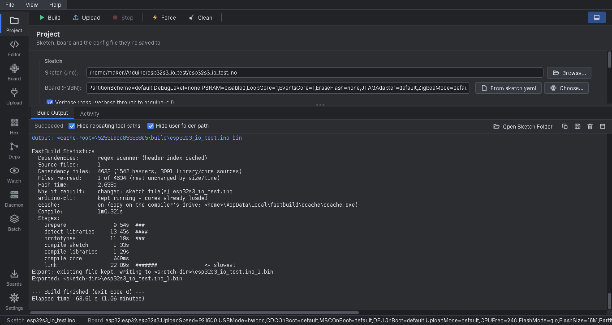
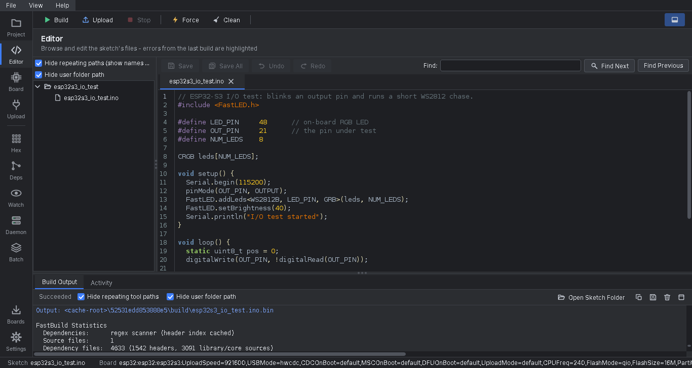
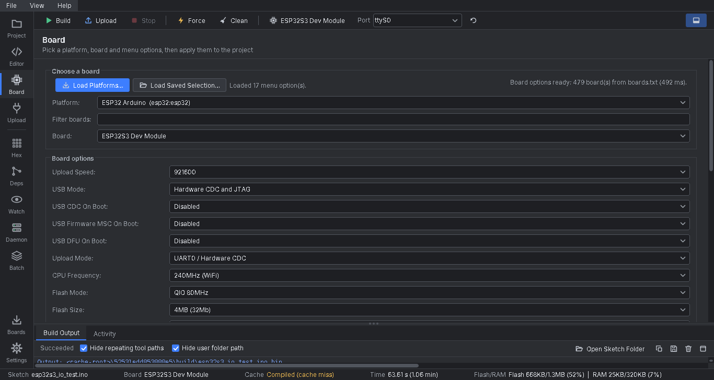
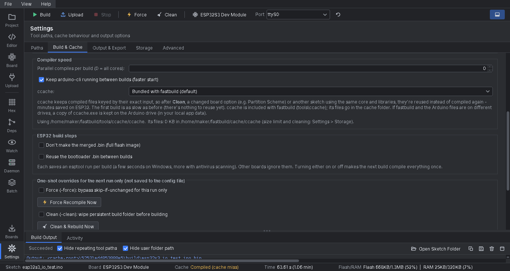
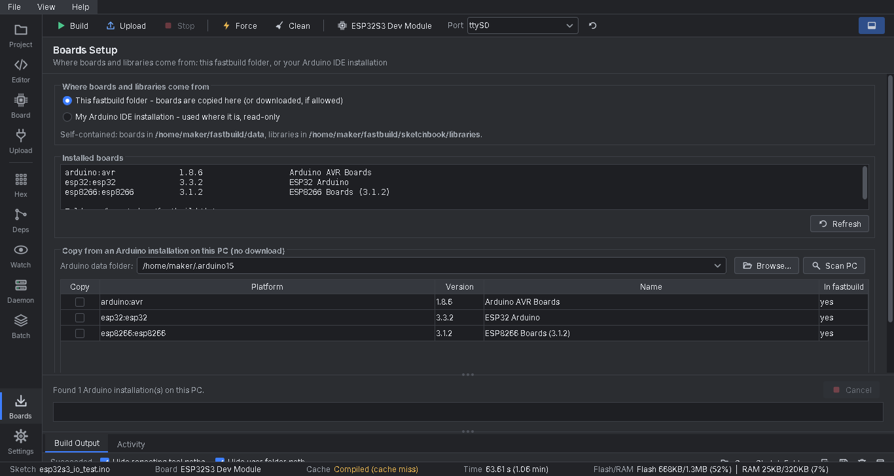

# arduino-fastbuild

**Faster Arduino builds for the edit → compile → upload loop.** Install your
boards once with the Arduino IDE, then let fastbuild do the rebuilds: it skips
builds where nothing changed, reuses everything that didn't change, and keeps
arduino-cli warm between builds. Ready to run on Windows: unzip, start, build.

## How much faster?

Measured on an ESP32-S3 sketch using FastLED (Windows, linked to the Arduino
IDE's boards):

| Build | Time |
|---|---|
| First build of a sketch (everything compiles) | ~15 min |
| Full rebuild later (after Clean or a board-option change), ccache filled | ~4.7 min |
| One-line change (e.g. a pin number) | ~1 min |
| Nothing changed | 3–6 s |

## Features

- **Skips unchanged builds.** fastbuild fingerprints your sketch, every
  library and core file it uses, the board options and the toolchain. If
  nothing changed, the previous firmware is reused without running arduino-cli.
- **Explains every rebuild.** "Why it rebuilt" names what changed (sketch
  file, library, board option, core version), and the statistics show how long
  each build stage took.
- **ccache built in.** Compiled files are reused across Clean, board-option
  changes and other sketches. Works even when fastbuild and the Arduino folders
  are on different drives.
- **arduino-cli kept running.** Installed cores and tools are loaded once
  instead of on every build. On by default, one checkbox to turn off.
- **ESP32 extras (optional).** Skip the 16 MB merged .bin and reuse the
  bootloader instead of running esptool on every build.
- **Instant board options.** Menus (Partition Scheme, Flash Size, CPU
  Frequency...) are read straight from `boards.txt`: 479 ESP32/ESP8266/AVR
  boards in under half a second.
- **Uses your Arduino IDE's boards and libraries in place**, read-only, or
  copies them into the fastbuild folder for a fully portable setup.
- **Offline by default.** Nothing is downloaded unless you allow it and agree
  to the list of files and sizes first.
- **Built-in editor, serial monitor, hex viewer, batch builds, watch mode and
  storage cleanup.**

| | |
|---|---|
|  |  |
| **Editor** with save, undo/redo and build errors highlighted | **Board options** read straight from `boards.txt` |
|  |  |
| **Compiler speed**: ccache, kept-running arduino-cli, ESP32 steps | **Boards Setup**: use the IDE's boards or copy them |

## Getting started

1. Download `fastbuild-<version>-windows.zip` from [Releases](../../releases)
   and unzip it to a short folder without spaces, e.g. `C:\fastbuild`
   (not under Program Files).
2. Install Java 8 or newer if you don't have it
   ([Eclipse Temurin](https://adoptium.net/)).
3. Run `fastbuild-ui.bat`. On first start, **Boards Setup** asks where boards
   and libraries come from: your Arduino IDE installation, or a copy in the
   fastbuild folder.
4. Pick your sketch on **Project**, your board on **Board**, and press
   **Build** (Ctrl+B).

arduino-cli 1.6.0 and ccache 4.14.3 are included; only Java is needed. A
command-line version (`fastbuild.exe`) is in the same folder. Run
`fastbuild -h` for its options.

## License

fastbuild is released under the [MIT License](LICENSE).

The release zip also contains, unmodified, [arduino-cli](https://github.com/arduino/arduino-cli)
(GPL-3.0) and [ccache](https://ccache.dev) (GPL-3.0-or-later), which fastbuild
runs as separate programs. Their license texts are in the `licenses` folder of
the release, and their source code is published with each release.
